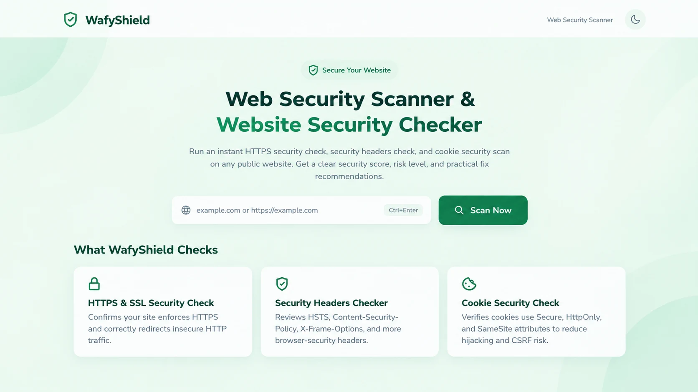

# WafyShield

**A lightweight web security scanner for HTTPS/SSL, security headers, and cookie security.**

WafyShield checks a publicly accessible website and reports a security score, risk level, `PASS` / `WARNING` / `FAIL` results, and practical recommendations for improving its security. Scan history is stored in your browser using `localStorage`.

**Live website:** https://shield.amwafy.xyz/

## Preview

<p align="center">
  
</p>

## What it checks

- **HTTPS and SSL:** checks whether the final page is served over HTTPS and can retrieve TLS certificate details.
- **Security headers:** checks headers such as HSTS, Content-Security-Policy, X-Frame-Options / CSP frame-ancestors, X-Content-Type-Options, Referrer-Policy, and Permissions-Policy.
- **Cookie security:** checks the `Secure`, `HttpOnly`, and `SameSite` attributes on cookies returned by the target.
- **Security score and risk level:** summarizes the checks with `PASS`, `WARNING`, or `FAIL` results.
- **Recommendations:** provides guidance for checks that need attention.
- **Scan history:** keeps recent scan results in the current browser using `localStorage`.
- **JSON report:** lets you download the displayed scan result as a JSON report.
- **Light and dark themes:** supports switching the interface theme.

## Tech stack

- Next.js 14
- React 18
- JavaScript
- Vercel deployment

## Run locally

### Requirements

- Node.js and npm

### Install and start

```bash
git clone https://github.com/afeemuhammodwafy1/wafyshield.git
cd wafyshield
npm install
npm run dev
```

Open [http://localhost:3000](http://localhost:3000).

### Create a production build

```bash
npm run build
npm start
```

## Deploy to Vercel

1. Push the project to your GitHub repository.
2. In Vercel, choose **Add New Project** and import the existing `wafyshield` repository.
3. Confirm that Vercel detects Next.js.
4. Deploy the project.

The project does not require a database or environment variables for its current configuration.

## Project structure

```text
pages/
  _app.js          Global app setup and theme
  index.js         Scanner interface, metadata, and browser history
  404.js           Custom not-found page
  api/
    scan.js        Server-side website scan endpoint
public/
  robots.txt       Crawler rules
  sitemap.xml      Sitemap
docs/
  images/
    wafyshield-home.webp  README preview screenshot
middleware.js      API request rate limiting
next.config.js     Next.js configuration and response security headers
package.json       Dependencies and npm scripts
```

## Privacy and limitations

- Scan history is stored in the browser's `localStorage`; it is not a database-backed account history.
- The scanner requests publicly accessible URLs and checks the response information available to it. Results are a useful first-pass review, not a full penetration test or guarantee that a website is secure.
- Localhost and several private or internal address ranges are blocked by the scanner.
- Do not use a scan result as a substitute for a comprehensive security assessment.

## License

WafyShield is licensed under the [MIT License](https://github.com/afeemuhammodwafy1/wafyshield/blob/main/LICENSE).

You may use, copy, modify, distribute, and include this software in commercial projects, subject to the terms of the MIT License.

